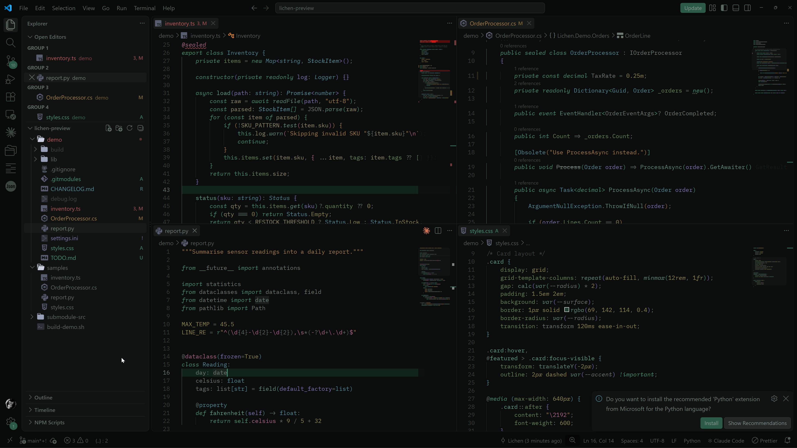

# Lichen



Ultra low contrast dark theme for VS Code. Green-tinted near-black background (`#0b0d0c`), plain text around 4:1
contrast, comments around 2:1, with muted mint, amber, ochre, teal, lavender and sage accents.

Keywords, storage types, function calls, decorators and TypeScript type annotations are italic.

## Other apps

The repository also has Lichen for these apps. They aren't part of the VS Code extension.

### Notepad++

Close Notepad++, then run:

```powershell
.\notepadplusplus\install.ps1
```

This copies `Lichen.xml` into `%APPDATA%\Notepad++\themes` and switches Notepad++ dark mode to Lichen, UI colours
included. `config.xml` is backed up to `config.xml.lichen-backup` first. If Notepad++ is portable or its install
folder has `doLocalConf.xml`, pass `-ConfigDir <install folder>`.

`notepadplusplus/generate.py` rebuilds `Lichen.xml` from Notepad++'s bundled `DarkModeDefault.xml`.

### Windows Terminal

Add the object in `windows-terminal/lichen.json` to `"schemes"` in Windows Terminal's `settings.json`, then set
`"colorScheme": "Lichen"` on a profile or under `profiles.defaults`.

### Claude Code

Copy `claude-code/lichen.json` to `%USERPROFILE%\.claude\themes\` (`~/.claude/themes/` on macOS and Linux) and pick
Lichen in `/theme`. If the `themes` folder didn't exist yet, restart Claude Code first. Diffs and inline code keep
Claude Code's own colours.
